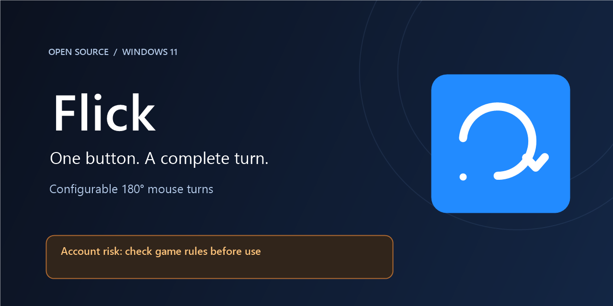
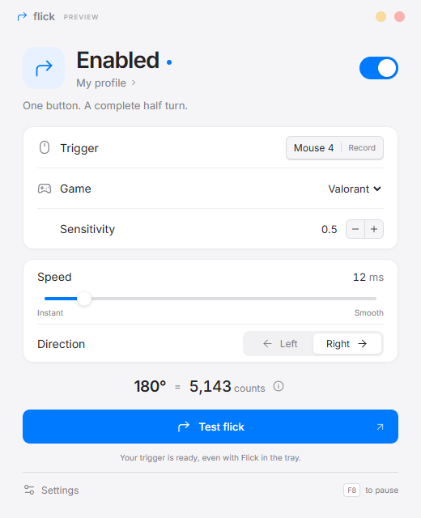
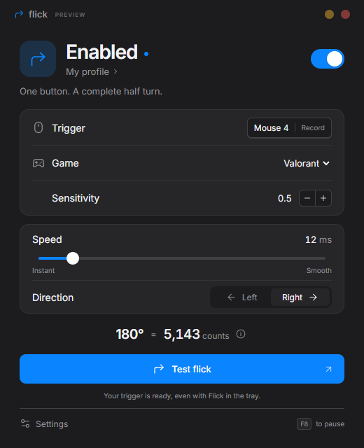

# Flick

A little motion. A complete turn.

Flick is a small Windows 11 tray app for a configurable, one-button 180° mouse turn. Built with Tauri 2, Rust, React and TypeScript. Works through standard Windows mouse input, independent of mouse vendor software.

> [!WARNING]
> **Account ban risk:** Flick automates a turn from one press. Online games may prohibit this even though it uses standard Windows input and does not inject into a game. A publisher may suspend or permanently ban an account. **Check each game's current rules before use; only use Flick where input automation is allowed.** Valorant and Fortnite presets are math conversions, not publisher approval. Flick starts paused and requires an in-app acknowledgment before it can be enabled. See [Account safety](docs/SAFETY.md).



| Light                                                | Dark                                               |
| ---------------------------------------------------- | -------------------------------------------------- |
|  |  |

Screenshots show the browser preview of the same interface. Native windows use Windows 11 corner rounding, shadow, and Mica where supported; the interface has an opaque solid fallback.

## Features

- Record either side button, middle click, or a keyboard key. F8 is reserved for enable/pause; F9 for calibration, and Escape cancels recording.
- Relative `SendInput` movement with exact integer step totals and fractional remainder tracking between turns.
- Instant through 100 ms duration, left/right, optional equal-and-opposite turn on release.
- Sourced Valorant and Fortnite sensitivity scales, Custom yaw, cm/360 + DPI, and raw counts.
- Manual Raw Input calibration using F9 while in game.
- Multiple profiles, optional foreground `.exe` matching, tray toggle, single-instance operation, optional startup with Windows.
- System/light/dark appearance, local Inter font, Lucide icons, keyboard navigation and reduced-motion support. No CDN or telemetry.

## Install

Use the `Flick_*_x64-setup.exe` NSIS installer from the [latest GitHub Release](https://github.com/neqxusfn/flick/releases/latest), or run the standalone `Flick-portable-x64.exe`. Release artifacts are generated when a maintainer pushes a `v*` tag. Nothing is published simply by building locally.

Requires Windows 11 x64 and Microsoft Edge WebView2 Runtime (normally already installed). The small installer can bootstrap WebView2 if missing; the portable app needs it installed separately. The standalone executable still stores preferences in `%APPDATA%/Flick/`, so it is not a fully self-contained USB configuration. Builds are currently unsigned.

## Use

1. Open Flick. It starts **paused** so your mouse behaves normally.
2. Select a sourced game and enter its in-game sensitivity. Fortnite uses the displayed percentage: enter `10` for `10%`.
3. Click the trigger field and press a side button, middle button, or key within 15 seconds. Press Escape to cancel. Remove conflicting game bindings yourself: Flick cannot inspect game bindings.
4. Read and acknowledge the account-risk notice, then choose duration and direction. Enable Flick, or press **F8**. The bound down/up events are swallowed while enabled; injected input and unrelated input are passed through. Some games consume Raw Input independently, so unbind the same action in game.
5. Try **Test flick**. This sends a real mouse movement immediately to the foreground application. On the desktop it moves the pointer; it only corresponds to 180° inside a game with matching settings.
6. Close the window to keep Flick in the tray. Left-click its tray icon to reopen it; right-click for Enable/Disable, profile, Open, and Quit.

### Calibration and profiles

Open **Settings → Calibration** to choose:

- **Game sensitivity:** `180 / (sensitivity × yaw)`. For Custom, enter your known yaw in Settings.
- **Distance + DPI:** enter the measured distance for a full 360° and your actual mouse DPI.
- **Raw counts:** directly enter the counts needed for 180°.

For the helper, click **Calibrate**, switch to your game and aim at a precise landmark. Press **F9**, manually turn exactly 180°, then press **F9** again. Flick saves the absolute net horizontal Raw Input count to the active profile and selects Raw counts mode. Corrections in the opposite direction subtract. Use only the intended mouse during measurement; relative packets from all mice are counted. Absolute tablet packets and input without a physical device handle are ignored. Calibration times out after two minutes, and Flick stays paused afterward. Repeat to check accuracy.

Create/rename/delete profiles in Settings. Each profile includes its mode, sensitivity, yaw/distance/counts, trigger, duration, direction, return behavior and optional process name. Enable automatic switching and enter a unique executable basename (for example `cs2.exe`). Matching is case-insensitive, checked every 500 ms, and keeps the last profile when there is no match. Calibration and recording suspend switching. Automatic selections are session-only; manually saved selections persist.

`%APPDATA%/Flick/profiles.json` is versioned JSON. Saves validate values, flush to disk, then replace the old file atomically. If a corrupt/unsupported file is encountered, Flick displays a recovery message; the first subsequent save preserves a timestamped `.recovery-*.json` copy.

### Precision

For sensitivity `1.5` and a **user-provided** yaw of `0.022`, the ideal half turn is `5454.54545…` counts. The first turn sends `5455`, and later turns carry the remainder, keeping cumulative rounding error within half a count. Changing the active profile's settings resets that remainder. An optional return sends exactly the negative of that press's integer total.

Distance mode uses `(cm360 / 2) / 2.54 × DPI`. Raw mode uses the entered count. Counts are limited to 1–1,000,000 per turn to reject invalid configurations. Integer error diffusion splits a nonzero-duration turn across `duration_ms + 1` steps, with the first at time zero and the last scheduled at the requested duration. Instant mode sends one event. A high-resolution Windows waitable timer schedules steps; no `Sleep` is used for flick timing. Windows scheduling and a game's own input sampling can still affect observed timing.

## Compatibility and responsible use

**Flick never injects into game processes, reads game memory, or hooks game APIs.** All output is relative `SendInput` mouse motion: no absolute or virtual-desktop flags. Low-level Windows keyboard/mouse hooks run in Flick's own process. Foreground process inspection requests only limited query access for the executable name and elevation status.

Some games reject simulated input or treat input automation as a macro. Use only where automation is explicitly allowed. You are responsible for checking the game's rules; this app does not bypass anti-cheat and cannot guarantee account safety. Preset availability does not imply a game accepts Flick. ADS/scopes, acceleration, custom multipliers, and game updates can change results. [Publisher policy links and account safety](docs/SAFETY.md) · [Preset sources and omitted games](docs/yaw-sources.md).

- Turn off Windows **Enhance pointer precision** for consistent movement; Flick detects and warns, but does not alter your mouse settings.
- Monitor position, DPI scaling and virtual desktop origins are not used for count math. Desktop cursor movement can hit a monitor edge, so do not judge an in-game turn from desktop pixel distance.
- Run normally first. If the foreground game is elevated, Flick offers **Run as administrator**, which opens the standard Windows UAC prompt. Cancelling leaves Flick running normally. A successful restart starts paused. Some protected processes hide their elevation state; input failure still produces a clear message.
- Simultaneous presses during a turn are discarded instead of piling up delayed flicks. Disabling cancels remaining steps and invalidates queued returns.
- A low-level hook can be silently removed by Windows if the thread is stalled beyond the OS timeout. The callbacks only perform atomic checks and a bounded nonblocking channel send, but restart Flick if physical triggers stop responding.

## Build and verify

Install Node.js 22+ (tested with 24), stable Rust MSVC, Microsoft Visual Studio Build Tools with **Desktop development with C++** and Windows SDK, and WebView2. See [Tauri's Windows prerequisites](https://v2.tauri.app/start/prerequisites/).

```powershell
npm ci
npm run tauri dev
```

Browser-only visual preview: `npm run dev`. It explicitly labels itself **PREVIEW** and cannot record global input, calibrate, or send mouse movement. Preview edits are not saved to disk.

The npm Tauri launcher uses a normal Rust installation first. In this development workspace it can also find the isolated toolchain in ignored `.tools/`; no global PATH change is needed.

```powershell
npm run build
npm run lint
npm run format:check
npm test
npm run test:ui
cargo fmt --manifest-path src-tauri/Cargo.toml -- --check
cargo clippy --manifest-path src-tauri/Cargo.toml --all-targets -- -D warnings
cargo test --manifest-path src-tauri/Cargo.toml
npm run tauri build -- --target x86_64-pc-windows-msvc
```

Playwright uses installed Microsoft Edge. Its six projects cover light/dark at 1×, 1.25×, and 1.5× device scale and capture screenshots in ignored `test-results/`. These checks verify CSS layout and rasterization; actual Windows display scaling and physical multi-monitor/input behavior also require hands-on checks.

Local build outputs (ignored by Git):

- Installer: `src-tauri/target/x86_64-pc-windows-msvc/release/bundle/nsis/`
- Portable executable: `src-tauri/target/x86_64-pc-windows-msvc/release/flick.exe`

The release workflow runs tests/lint/format, builds on `windows-latest`, uploads artifacts, and attaches the installer plus renamed portable executable to a GitHub Release on tag push. Signing is not configured.

## Structure

```text
src/                 React interface, components, hooks, plain CSS
src-tauri/src/
  math.rs            Pure count conversion and step partitioning
  hook.rs            Dedicated low-level hook/message-loop thread
  flick.rs           Relative SendInput and waitable timer
  calibration.rs     Hidden message window WM_INPUT measurement
  profiles.rs        Validation and atomic JSON persistence
  engine.rs          Event coordinator and separate motion worker
  platform.rs        Process-name, acceleration and elevation checks
  tray.rs            System tray and window activation
tests/               Browser interaction and scaling checks
docs/                Preset evidence and verification notes
```

## License

[MIT](LICENSE). Inter is bundled under the SIL Open Font License; Lucide under ISC. See [third-party notices](THIRD_PARTY_NOTICES.md).
